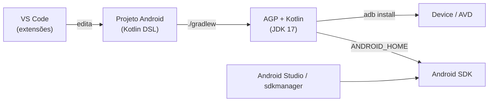

<div align="center">


# Android Config

Scripts, templates e documentação para desenvolvimento **Android com Kotlin + Jetpack Compose** usando **VS Code** como editor e **Gradle CLI** como sistema de build.

---

## Arquitetura do ambiente



O Android Studio é usado apenas para gerenciar SDK, emuladores e AVDs; edição, build e deploy acontecem fora dele.

## Requisitos

| Componente | Versão | Obrigatório |
| ---------- | ------ | ----------- |
| JDK | 17 (requisito do AGP 8.x) | Sim |
| Android SDK Platform |  `compileSdk` do projeto | Sim |
| Android SDK Build-Tools / Platform-Tools | latest | Sim |
| Android SDK Command-line Tools | latest | Recomendado |
| Android Studio | qualquer recente | Recomendado (gerência do SDK) |
| VS Code + CLI `code` no PATH | qualquer recente | Sim |
| Gradle | via wrapper do projeto (`gradlew`) | Sim |
| Android Emulator ou device físico | — | Para executar |

Sistemas suportados: Linux (bash 4+) e Windows 10 1511+ / 11.

## Quick start

```bash
git clone https://github.com/luizfrz/Android_Config.git
cd meu-projeto-android

```
#### Linux 
```bash 

../Android_Config/scripts/linux/setup-env.sh  

../Android_Config/scripts/linux/configure-vscode.sh  

../Android_Config/scripts/linux/build-apk.sh -i      
```
#### Windows 

```bat

..\Android_Config\scripts\windows\setup-env.bat 
..\Android_Config\scripts\windows\configure-vscode.bat
..\Android_Config\scripts\windows\build-apk.bat /install
```

### Script 

```text
setup-env ->  valida JDK/SDK/ADB, ajusta ANDROID_HOME, instala extensões 
configure-vscode ->  .vscode/ + .editorconfig no projeto
build-apk ->  /install  assembleDebug + adb install
```

Todos os scripts aceitam o diretório do projeto como argumento (padrão: diretório atual) e `--help` / `/?`.

## Scripts
### `setup-env` — validação e configuração do ambiente

| Etapa | Verificação / ação |
| ----- | ------------------ |
| 1 | `java` ≥ 17 e presença de `javac` (JDK completo), `JAVA_HOME` |
| 2 | `kotlinc` (opcional — o Kotlin do projeto vem do Gradle) |
| 3 | `ANDROID_HOME`; se ausente, define e persiste (`~/.bashrc`/`~/.zshrc` ou variável de usuário no Windows) |
| 4 | `platform-tools`, `emulator`, `cmdline-tools/latest/bin`, `build-tools`, `platforms` |
| 5 | `adb` |
| 6 | `gradlew` e `gradle/libs.versions.toml` no projeto |
| 7 | `adb devices -l` |
| — | Instala extensões de `templates/vscode/extensions.json` e remove `fwcd.kotlin` |

Sai com código `1` se houver erro bloqueante (sem JDK, sem SDK, sem ADB). Linux: `--no-rc` não altera arquivos de shell, `--no-extensions` pula o VS Code.

No Windows, o `PATH` é atualizado via PowerShell apenas no escopo de **usuário** e sem duplicar entradas — evita o truncamento em 1024 caracteres do `setx`.

### `build-apk` — build e deploy

| Linux | Windows | Efeito |
| ----- | ------- | ------ |
| `-r`, `--release` | `/release` | `assembleRelease` em vez de `assembleDebug` |
| `-i`, `--install` | `/install` | Instala sem perguntar |
| `-n`, `--no-install` | `/noinstall` | Não instala (uso em CI) |
| `--no-clean` | `/noclean` | Pula `gradlew clean` (builds incrementais) |
| `-s SERIAL` | — | Device alvo (`ANDROID_SERIAL`) |

Localiza o APK mais recente em `*/build/outputs/apk/**/<variant>/`, cobrindo módulos com nome customizado e product flavors. Instala com `adb install -r -t`. APKs release `*-unsigned.apk` não são instalados.

### `configure-vscode` — configuração do projeto

Instala as extensões e copia `templates/vscode/{settings,extensions}.json` → `.vscode/` e `templates/editorconfig` → `.editorconfig`. Arquivos existentes com conteúdo diferente são salvos como `*.bak.<timestamp>` antes de serem substituídos.

## Documentação

[Arquitetura técnica](docs/architecture.md)
 [Setup Linux](docs/setup/linux.md) · [Setup Windows](docs/setup/windows.md)
 [Gradle + Jetpack Compose](docs/reference/gradle-compose.md)
 [VS Code](docs/reference/vscode.md)

