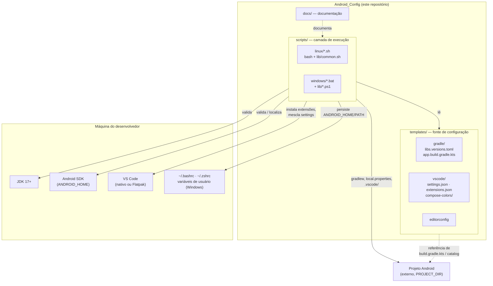
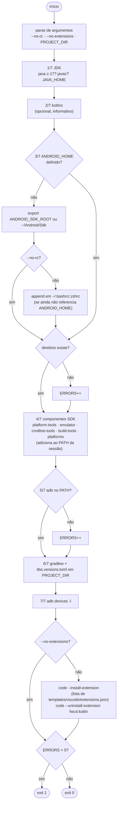
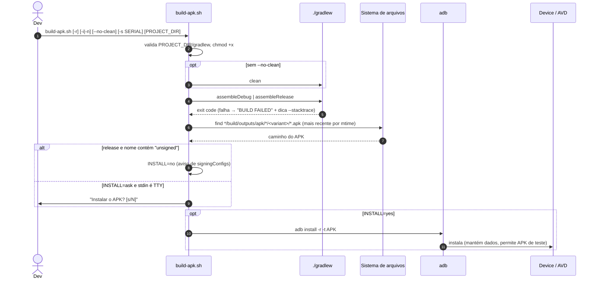
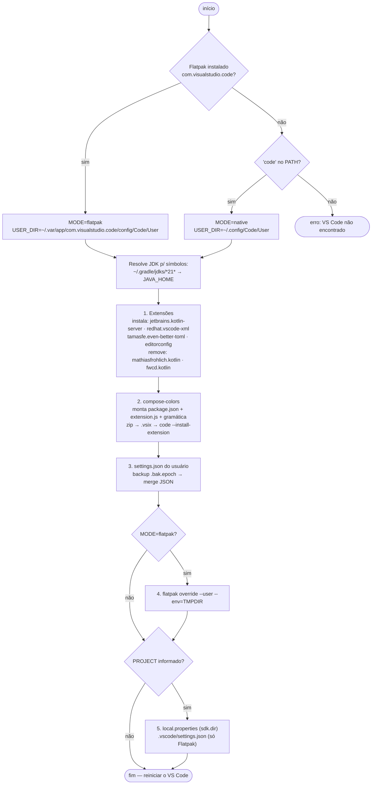
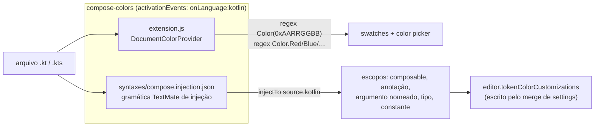
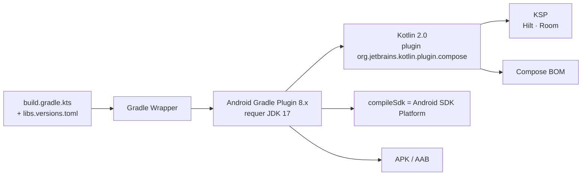

## 1. Visão geral

O repositório **não contém um app Android**. Ele é um *toolkit* de ambiente: scripts que validam/configuram a máquina, templates que são copiados para projetos Android e documentação. O projeto Android do usuário é externo e é sempre passado por argumento (`PROJECT_DIR`, padrão `$PWD`).

## 2. Camadas e responsabilidades

| Camada | Caminho | Responsabilidade | Não deve |
| ------ | ------- | ---------------- | -------- |
| Execução | `scripts/linux`, `scripts/windows` | Orquestrar verificação, configuração e build | Conter listas de extensões/settings duplicadas |
| Biblioteca | `scripts/*/lib` | Cores, logging, helpers (`install_file`), merge de JSON | Ter efeitos colaterais ao ser carregada |
| Configuração | `templates/` | Fonte única de settings, extensões, catálogo Gradle, extensão local | Depender de caminhos da máquina |
| Documentação | `docs/`, `README.md` | Explicar uso e decisões | — |

Princípio: **templates são a fonte única**; scripts apenas leem e aplicam. Ver [divergências conhecidas](#8-divergências-conhecidas) para os pontos onde isso ainda não é verdade.

## 3. Paridade Linux ↔ Windows

| Responsabilidade | Linux (bash) | Windows (cmd + PowerShell) |
| ---------------- | ------------ | -------------------------- |
| Cores / logging | `lib/common.sh` (`ok`, `warn`, `fail`, `step`, `header`, `die`) | `lib/colors.bat` (variáveis ANSI) |
| Raiz dos templates | `TEMPLATES_DIR` calculado em `common.sh` | `%~dp0..\..\templates` |
| Validação do ambiente | `setup-env.sh` | `setup-env.bat` |
| Build + deploy | `build-apk.sh` | `build-apk.bat` |
| Configuração do VS Code | `configure-vscode.sh` | `configure-vscode.bat` |
| Merge de `settings.json` | `python3` embutido (heredoc) | `lib/merge-settings.ps1` |
| Empacotar `compose-colors` | `zipfile` do `python3` embutido | `lib/build-compose-colors.ps1` |
| Persistência de `ANDROID_HOME` | append em `~/.bashrc`/`~/.zshrc` | PowerShell, escopo **usuário**, sem duplicar PATH |
| Detecção do VS Code | Flatpak (`com.visualstudio.code`) → nativo (`code`) | `code` no PATH |

## 4. Fluxos dos scripts

### 4.1 `setup-env` — diagnóstico do ambiente

Etapas sequenciais; erros bloqueantes incrementam `ERRORS`, avisos não. O script usa `set -uo pipefail` (sem `-e`) justamente para continuar e reportar todos os problemas de uma vez.

Códigos de saída: `0` ok · `1` erro bloqueante (sem JDK, sem SDK, sem ADB) ou opção inválida.

### 4.2 `build-apk` — build e deploy

Usa `set -euo pipefail`: qualquer falha não tratada aborta o script.

Decisões:
- **Busca do APK por `find` + mtime** em vez de caminho fixo: cobre módulo com nome diferente de `app` e *product flavors* (`apk/<flavor>/<variant>/`).
- **`-r`** reinstala preservando dados; **`-t`** aceita APKs marcados como teste (debug builds).
- **Não interativo** (CI): sem TTY, `ask` vira "não instala".
- `-s SERIAL` exporta `ANDROID_SERIAL`, respeitado pelo `adb` sem precisar passar `-s` a cada chamada.

### 4.3 `configure-vscode` — editor

Por que o `TMPDIR` compartilhado no Flatpak: o `/tmp` do sandbox é privado, então o servidor LSP (dentro do sandbox) e o Gradle (no host) não enxergam os mesmos arquivos temporários. O diretório `~/.cache/vscode-kotlin-tmp` é visível aos dois. Pelo mesmo motivo o `.vsix` é gerado sob `$HOME`, e o terminal integrado usa `flatpak-spawn --host` para rodar o Gradle fora do sandbox.

## 5. Extensão local `compose-colors`

Extensão VS Code mínima mantida em `templates/vscode/compose-colors/`, sem dependências de runtime.

- **Cores**: `HEX_RE` reconhece `Color(0x…)` com 6–10 dígitos hex (aceita `_`); valores são interpretados como **ARGB**. `NAMED_RE` cobre 11 cores nomeadas de `Color.*`. Cores nomeadas não são reescritas pelo picker (`provideColorPresentations` retorna `[]`); só literais hex.
- **Realce**: a gramática usa `injectionSelector: "L:source.kotlin -comment -string"` para ter prioridade sem substituir a gramática Kotlin existente. Funções com inicial maiúscula seguidas de `(` ou `{` são tratadas como `@Composable`.
- **Empacotamento**: `.vsix` é um zip com `[Content_Types].xml`, `extension.vsixmanifest` e `extension/`. Gerado em tempo de execução (Python no Linux, PowerShell no Windows), sem `vsce`/Node.

## 6. Contratos e convenções

**Argumentos.** Todo script aceita `PROJECT_DIR` posicional (padrão `$PWD`) e `-h/--help` (`/?` no Windows). A ajuda é extraída do cabeçalho de comentários (`sed -n '2,Np'`), então o cabeçalho é parte da interface.

**Variáveis de ambiente.**

| Variável | Lida por | Escrita por | Observação |
| -------- | -------- | ----------- | ---------- |
| `ANDROID_HOME` | todos | `setup-env` (sessão + rc/usuário) | fallback: `ANDROID_SDK_ROOT` → `~/Android/Sdk` |
| `ANDROID_SERIAL` | `adb` | `build-apk -s` | seleciona o device |
| `JAVA_HOME` | `setup-env`, `configure-vscode` | — | só informativo; `java` no PATH basta |
| `TMPDIR` | servidor Kotlin LSP | `flatpak override` | apenas Flatpak |

**Arquivos que os scripts modificam fora do repositório.**

| Arquivo | Script | Proteção |
| ------- | ------ | -------- |
| `~/.bashrc` / `~/.zshrc` | `setup-env` | só se não houver `ANDROID_HOME`; desligável com `--no-rc` |
| `<User>/settings.json` do VS Code | `configure-vscode` | backup `.bak.<timestamp>` e merge (preserva chaves não gerenciadas) |
| `<projeto>/local.properties` | `configure-vscode` | só acrescenta `sdk.dir` se ausente |
| `<projeto>/.vscode/settings.json` | `configure-vscode` | só cria se não existir (e só no Flatpak) |
| PATH de usuário (Windows) | `setup-env.bat` | PowerShell, sem duplicar, evita o limite de 1024 chars do `setx` |

**Idempotência.** Rodar duas vezes produz o mesmo estado: `grep` antes de escrever no rc, `--force` em extensões, merge de JSON em vez de sobrescrita, `install_file` só gera backup quando o conteúdo difere (`cmp -s`).

**Estilo.** Linux: `bash`, `shellcheck -x -S style` limpo. Windows: CRLF (via `.gitattributes`), sem `::` dentro de blocos `( )`, `call` ao invocar `.cmd`/`.bat`.

## 7. Toolchain alvo (o que os templates assumem)

Com Kotlin 2.0 o compilador do Compose é um plugin do Kotlin (`kotlin-compose`), não mais `composeOptions.kotlinCompilerExtensionVersion`. Detalhes e versões em [reference/gradle-compose.md](reference/gradle-compose.md).

## 8. Divergências conhecidas

Pontos em que a implementação atual foge do princípio "templates como fonte única" ou do que o README descreve:

1. **`scripts/linux/configure-vscode.sh` é autocontido.** Ele embute `package.json`, `extension.js`, a gramática, o manifesto e o merge de settings em heredocs, não usa `lib/common.sh` e não lê `templates/vscode/compose-colors/`. A versão Windows já lê dos templates. Risco: as duas cópias da extensão divergirem.
2. **Linux não copia `templates/vscode/*.json` nem `templates/editorconfig`.** O README diz que `configure-vscode` instala `settings.json`, `extensions.json` e `.editorconfig` no projeto; hoje o script Linux gera as configurações via Python inline.
3. **Listas de extensões conflitantes.** `setup-env` instala as extensões de `templates/vscode/extensions.json` (inclui `mathiasfrohlich.Kotlin`), enquanto `configure-vscode` desinstala `mathiasfrohlich.kotlin` e usa `jetbrains.kotlin-server`. Rodar os dois em sequência alterna as extensões.
4. **Sem CI.** O workflow de lint (`shellcheck`, finais de linha, validação dos templates) foi removido; as convenções da seção 6 hoje não são verificadas automaticamente.
5. **Cabeçalho de `configure-vscode.sh`** cita `./scripts/setup-vscode-kotlin.sh`, nome antigo do arquivo.

Caminho de convergência sugerido: (a) fazer o script Linux ler `templates/vscode/compose-colors/` e empacotar a partir dali; (b) mover o merge de settings para um único `templates/vscode/settings.json` aplicado por `jq`/Python nos dois sistemas; (c) alinhar `extensions.json` com o que `configure-vscode` realmente instala; (d) restaurar um job de lint.
